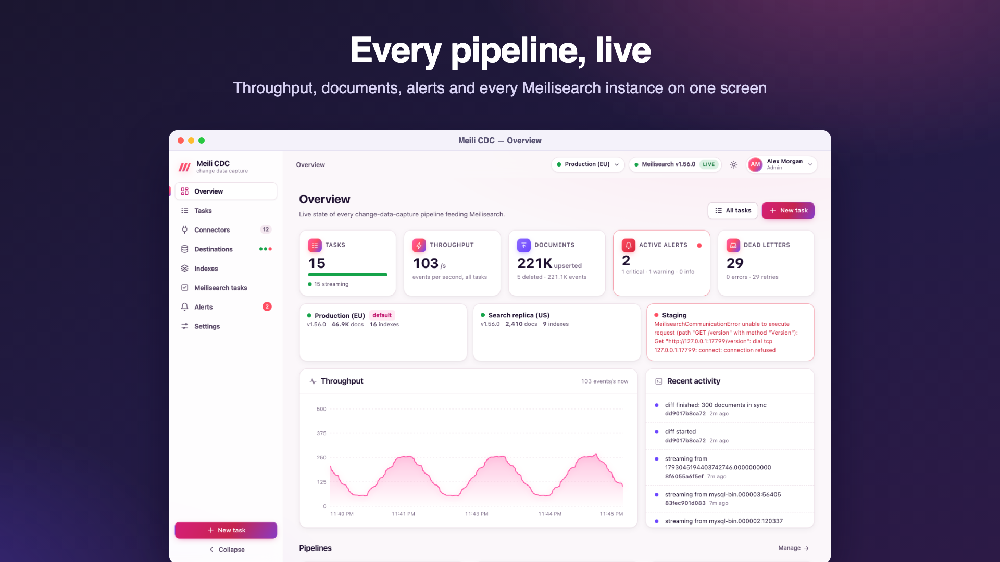

# meilisearch-cdc

Change data capture from your databases into [Meilisearch](https://www.meilisearch.com), managed from a live dashboard.

meilisearch-cdc copies a table once, then streams every insert, update and delete into a Meilisearch index in near real time.

- It is a single Go binary with an embedded state store.
- It uses the official [meilisearch-go](https://github.com/meilisearch/meilisearch-go) SDK.
- It starts with **zero configuration**. Sources, Meilisearch destinations, sync tasks, users, alerts and AI access are all managed in the UI.



Website: https://meilicdc.javad.dev/ · Guide: https://meilicdc.javad.dev/guide/ · [Screenshot tour](docs/screenshots.md)

## Run it

Download the archive for your system from the [latest release](https://github.com/ja7ad/meilisearch-cdc/releases/latest) (Linux, macOS and Windows on amd64 and arm64; verify it with `checksums.txt`), then:

```bash
tar -xzf meilisearch-cdc_*_linux_amd64.tar.gz && ./meilisearch-cdc_*/meilisearch-cdc
# or with Docker (linux/amd64 and linux/arm64):
docker run -p 8080:8080 -v cdc-data:/data ghcr.io/ja7ad/meilisearch-cdc:latest
# or from source:
make build && ./bin/meilisearch-cdc
```

Open http://localhost:8080. The first visit creates the admin account. An onboarding flow then guides you through:

1. connecting a Meilisearch instance,
2. connecting a data source,
3. creating your first sync.

For a full demo (Meilisearch + Postgres with 10,000 products + a running sync), use:

```bash
docker compose -f deploy/docker-compose.yml up --build    # login admin@example.com / change-me-please
```

## Concepts

| | |
|---|---|
| **Connector** | A saved source connection: type and credentials, encrypted. It can be tested, and its tables, collections or topics browsed. |
| **Destination** | A named Meilisearch instance: URL, API key, gzip, timeout and health check interval (5 s to 1 h). It is checked in the background and its health (latency, failures, version, documents), synced tasks and last sync time update live. |
| **Task** | Connector + table → destination + index. It defines the column mapping, index settings, batching, retries and safety guards. Many sources map to many destinations: one table can feed several instances through several tasks. |

## Sources

| Source | Capture method |
|---|---|
| PostgreSQL | logical replication (`pgoutput`); needs `wal_level=logical` |
| MySQL 8 / MariaDB | binlog; needs `binlog_format=ROW`, `binlog_row_image=FULL` |
| MongoDB | change streams; needs a replica set |
| DynamoDB | DynamoDB Streams |
| CouchDB / Cloudant | `_changes` feed |
| SQL Server | native CDC change tables |
| CockroachDB | changefeeds |
| Kafka (Debezium) | Debezium JSON envelopes; covers Oracle, Db2, Cassandra… |
| Redis Streams | `XREAD` |
| Webhook | HTTP push to `/api/v1/ingest/{task}`, optionally HMAC-signed with a per-task secret; replies once the documents are searchable |
| SQL polling | incremental cursor column on any `database/sql` driver |

## Features

### Sync engine
- **Snapshot then stream, with no gap.** The source position is captured before the copy, and positions are checkpointed only after Meilisearch confirms the write. A crash (even `kill -9`) replays from the last checkpoint; writes are idempotent.
- **High throughput.**
  - Changes to the same document are coalesced within a batch, and batches are sent as pipelined NDJSON tasks.
  - The JSON encoder is hand-written and allocation-light; requests are gzipped and connections pooled.
  - See [docs/performance.md](docs/performance.md): Postgres reaches 84k–92k docs/s on snapshot and 39k–46k docs/s streaming against a real Meilisearch.
- **Resilience.**
  - Exponential backoff with jitter; a payload that is too large is split.
  - Failed tasks are re-applied without overwriting newer data.
  - A supervisor restarts the pipeline; when a source position is lost, the task resyncs automatically.
- **Index safety.**
  - Rejected ("poison") documents are isolated by bisection into a dead letter queue, where they can be replayed or discarded.
  - Mass-delete and truncate guards hold the task.
  - A primary key lock prevents a task from overwriting an index keyed differently.
  - **Zero-downtime resync** rebuilds into a shadow index and swaps it in.

### Index management
- Full Meilisearch settings per task, including granular filterable attributes, embedders, typo tolerance, synonyms, ranking rules and faceting.
- Settings are applied on start or on save, drift between desired and live settings is shown, and applying is one click.
- Search playground, documents browser, swap, compact, Meilisearch task monitor, dumps and snapshots, experimental features. Everything works per destination.

### Data quality
- The **schema checker** compares source columns, index fields (with coverage) and settings.
- The **diff checker** compares source and index document by document, field by field, and can repair missing, stale and extra documents.

### Operations and security
- **Accounts**: email and password (argon2id), with server-side sessions and CSRF protection.
- **Roles**: *viewer*, *moderator* (operates tasks) and *admin*. Nobody changes their own role.
- **Primary administrator**: the first admin owns the installation. Its role and account cannot be changed or deleted from the dashboard or the API; only the operator CLI transfers ownership or resets its password.
- **Operator CLI** (`meilisearch-cdc admin`, on the server): list and manage users, reset passwords, sign everyone out, turn MCP off, revoke MCP tokens, and purge stored data by scope (sessions, audit, alert history, dead letters, checkpoints, tasks, ... or all). It goes through the running service's admin socket, or works on the data directory while the service is stopped. See [docs/cli.md](docs/cli.md).
- **Invitations and password reset**: invitations are emailed when SMTP is configured; the "Forgot password" flow appears only when SMTP is configured.
- **Login protection**: brute-force rate limiting.
- **Audit log**: logins, user changes and settings changes are recorded.
- **Alerts**, with email, **Telegram** and webhook delivery:
  - Rules: task failed/held/retrying, lag, dead-letter growth, error bursts, stalled snapshots, Meilisearch down (per destination).
  - Delivery: cooldowns, resolve notifications, and a delivery log.
- **MCP server** (Model Context Protocol, Streamable HTTP at `/mcp`) for AI agents:
  - Admins enable or disable it.
  - Random bearer tokens can be rotated and revoked, and carry a role.
  - Tools and resources are allow-listed per role and checked on every call; mutating calls are audited.
- **Secrets**:
  - AES-256-GCM encryption at rest, with a key ring and rotation (`CDC_SECRET_KEY_PREVIOUS`).
  - Each ciphertext is bound to its record and field.
  - Secrets are decrypted only when a connection opens and are never returned by the API.
  - The key is auto-generated if not provided.
- **Observability**: Prometheus metrics at `/metrics`, a live dashboard over SSE, structured logs, optional `/debug/pprof` for admins.
- **Installable dashboard (PWA)**: install it as an app on desktop or phone; the app shell works offline, and a new release offers a one-click update.
- **Admin CLI**: `meilisearch-cdc admin` resets passwords, manages users and the primary administrator, revokes sessions and MCP tokens and purges data, with the service running or stopped ([docs/cli.md](docs/cli.md)).
- **Import/export** of tasks, and **declarative tasks** from a YAML file (GitOps).

## Configuration

Everything is optional; the dashboard manages the rest.

| Env | Flag | Default | |
|---|---|---|---|
| `CDC_LISTEN` | `-listen` | `:8080` | HTTP address |
| `CDC_DATA_DIR` | `-data-dir` | `./data` | state database and generated secret key |
| `MEILI_URL`, `MEILI_API_KEY` | `-meili-url` | | **pins the service to one Meilisearch instance**; leave unset to manage destinations in the dashboard |
| `CDC_SECRET_KEY` | `-secret-key` | generated in `secret.key` | base64 32-byte key or passphrase; `CDC_SECRET_KEY_PREVIOUS` for rotation |
| `CDC_ADMIN_EMAIL`, `CDC_ADMIN_PASSWORD` | | | create the first admin without the setup page |
| `CDC_ADMIN_TOKEN` | `-admin-token` | | static admin bearer token for scripts |
| `CDC_PUBLIC_URL` | `-public-url` | | base URL in emailed links (also settable in the SMTP settings) |
| `CDC_COOKIE_SECURE`, `CDC_TRUST_PROXY` | | `false` | for deployments behind a TLS-terminating proxy |
| `CDC_TASKS_FILE` | `-tasks` | | YAML tasks applied at startup; `${VAR}` is expanded |
| `CDC_PPROF` | `-pprof` | `false` | `/debug/pprof` for admins |
| `CDC_LOG_LEVEL`, `CDC_LOG_FORMAT` | | `info`, `text` | |

Every secret also has a `*_FILE` variant for Docker and Kubernetes secrets, e.g. `CDC_SECRET_KEY_FILE`, `MEILI_API_KEY_FILE`, `CDC_ADMIN_PASSWORD_FILE`, `CDC_ADMIN_TOKEN_FILE`.

The full REST API is documented in [docs/api.md](docs/api.md), and the operator CLI in [docs/cli.md](docs/cli.md):

```bash
meilisearch-cdc admin users reset-password --email you@example.com --generate
meilisearch-cdc admin purge sessions alert-events --yes
meilisearch-cdc admin --help
```

## Development

```bash
make test          # unit tests (race detector: make test-race)
make integration   # engine, API, auth, alerts, MCP, connectors, destinations against real services (Docker)
make e2e           # builds the binary; Postgres, MySQL, MariaDB, MongoDB, DynamoDB, Kafka end to end
make ui-test       # Playwright dashboard tests (mock API)
make ui-real       # Playwright against the real service: single instance (MEILI_URL) and multi-instance destinations
make load          # load tests with profiles; see docs/performance.md
make e2e-env       # every source + 2 Meilisearch + Mailpit in Docker, then `make ui-full`: see docs/e2e.md
```

Releases are built by `.github/workflows/release.yml` when a `v*` tag is pushed: tests, binaries for Linux, macOS and Windows on amd64 and arm64 with `checksums.txt`, a GitHub release (tags with a `-` suffix are pre-releases) and a multi-arch image on `ghcr.io/ja7ad/meilisearch-cdc`.

```bash
git tag v1.0.0 && git push origin v1.0.0
```

The dashboard is plain ES modules with Preact and htm, embedded in the binary. There is no build step.

See [CONTRIBUTING.md](CONTRIBUTING.md) for the rules a change has to follow.
